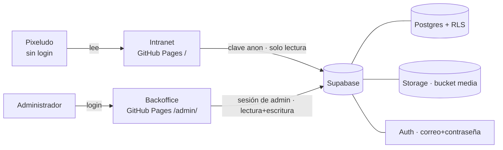

# SDD · Arquitectura (Modular)

## Vista general


## Decisiones
| # | Decisión | Motivo |
|---|---|---|
| D1 | Sin servidor propio: front estático + Supabase | Mantener hosting actual; costo ~0; menos cosas que fallen |
| D2 | La seguridad vive en la BD (RLS), no en el front | La clave `anon` es pública por diseño; solo RLS impide que un visitante escriba |
| D3 | Backoffice en `/admin/` del mismo repo, HTML + JS sin build | Mismo flujo de publicación; mismo Design System v2 |
| D4 | Registro público **desactivado**; los admins se crean/invitan desde Supabase | Evita que cualquiera se haga admin |
| D5 | Admin = usuario Auth **y** fila en tabla `admins` | Permite varios admins y quitar acceso sin borrar usuario |
| D6 | Imágenes en bucket `media` (lectura pública, escritura solo admins), máx. 3 MB, JPG/PNG/WebP | Control de peso y tipo |
| D7 | La intranet conserva el contenido actual como **respaldo** si Supabase no responde | Una caída del backend no deja la intranet vacía |
| D8 | Íconos: catálogo cerrado (clave de texto → SVG del Design System) | Consistencia visual; no se suben íconos libres |
| D9 | "Páginas internas" **no** se construyen ahora; el tipo de destino `page` queda reservado | Alcance MVP; evita rehacer el modelo de menús luego |

## Estructura del repo
```
index.html            intranet (lee de Supabase)
admin/index.html      backoffice (login + módulos)
assets/…              logos, pata, js compartido (cliente Supabase, mapa de íconos)
docs/…                TRAZA
```

## Lo que necesito de Alejo para construir
- Proyecto Supabase creado (URL + clave `anon`; la `service_role` **nunca** va al repo).
- Correos de los administradores iniciales.
