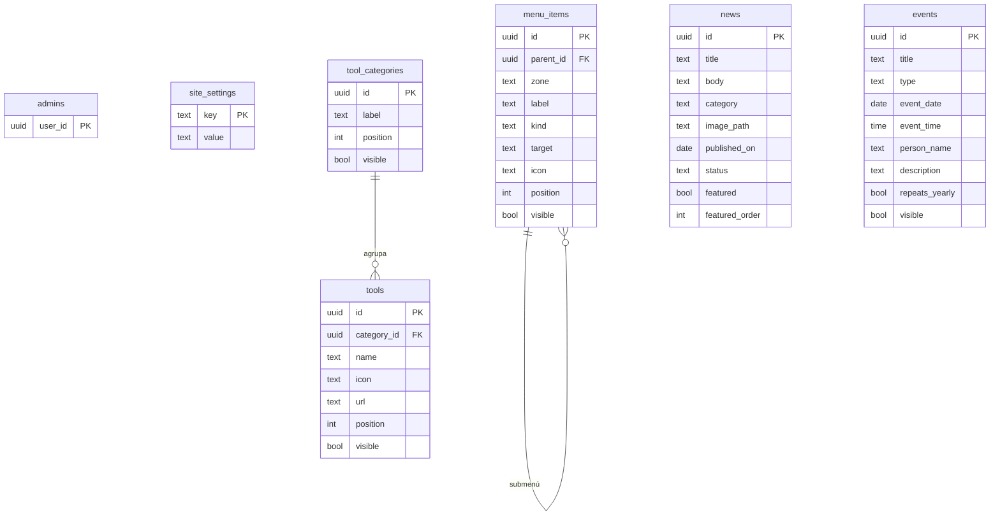

# SDD · Modelo de datos, permisos y reglas

## Tablas
- **site_settings** (clave/valor): `banner_image_path`, `banner_eyebrow`, `banner_title`, `banner_text`. Sin imagen → fondo de píxeles.
- **menu_items**: `zone` = `top` (junto al logo) o `quick` (accesos rápidos). `parent_id` nulo = menú principal; con valor = submenú (un nivel de profundidad). `kind` = `url` | `anchor` | `page` (reservado). `icon` solo aplica a `quick`.
- **tool_categories / tools**: las pestañas de herramientas salen de las categorías; cada herramienta con nombre, clave de ícono, URL, orden y visibilidad.
- **news**: `status` = `draft` | `published`; `featured` + `featured_order` (1 o 2).
- **events**: `type` = `cumple` | `reunion` | `capacitacion` | `otro`. `person_name` solo para cumpleaños (sin año de nacimiento). `repeats_yearly` por defecto verdadero en cumpleaños.
- **admins**: `user_id` de Supabase Auth.

## Permisos (RLS)
| Tabla | Visitante (anon) | Administrador |
|---|---|---|
| menu_items, tool_categories, tools, events | leer solo `visible = true` | todo |
| news | leer solo `status = 'published'` | todo |
| site_settings | leer | todo |
| admins | nada | leer |
| Storage `media` | leer | subir / borrar |
Admin = `exists(select 1 from admins where user_id = auth.uid())`.

## Reglas de negocio
1. **Máximo 2 destacadas:** función `set_featured(id, slot, replaces)` atómica + restricción única parcial en (`featured_order`) donde `featured`; la intranet muestra solo noticias `published` y `featured`, ordenadas por `featured_order`.
2. Una noticia en borrador no puede estar destacada.
3. Menús: máximo 1 nivel de submenú; borrar un menú con submenús pide confirmación y los borra en cascada.
4. Eventos repetidos anualmente se muestran cada año en el mismo día/mes; el 29-feb se muestra el 28-feb en años no bisiestos.
5. Imagen: JPG/PNG/WebP, ≤ 3 MB; nombre de archivo generado (uuid) para evitar colisiones.
6. Todo texto se escapa al pintarlo (sin HTML libre) para evitar inyección en la intranet pública.

## Pruebas obligatorias (plan)
- Como anon: `insert/update/delete` en cada tabla y subida a Storage → **deben fallar**.
- Como anon: no ver borradores ni ítems ocultos.
- Como admin: marcar una 3.ª destacada sin reemplazo → error; con reemplazo → ok.
- Cumpleaños 29-feb en año no bisiesto.
- Intranet con Supabase caído → muestra el respaldo.

## Riesgos (registro)
| Riesgo | Mitigación |
|---|---|
| Datos personales (cumpleaños) en sitio público | Solo nombre + día/mes; confirmar consentimiento con Pixel |
| Clave `service_role` filtrada | Nunca en el repo; solo `anon` |
| Admin se queda sin acceso | Mínimo 2 admins; recuperación de contraseña por correo de Supabase |
| Imágenes pesadas | Límite 3 MB y tipos permitidos |
| Plan gratuito de Supabase pausa proyectos inactivos | Visita periódica o plan Pro si la intranet pasa a ser crítica |

## Supuestos sobre preguntas abiertas del PRD (se ajustan si Alejo corrige)
1. "Los menús que siguen" = accesos rápidos + pestañas de herramientas (editables).
2. Cumpleaños: alta manual en el Corte 3; carga masiva CSV queda como mejora posterior.
3. Cumpleaños se repiten cada año.
4. Correos de admins: pendientes (necesarios antes de entregar el Corte 1).

---

# Enmiendas v2 (2026-11-12) — resultado de Fase 4 (tensión) y Fase 4.5 (auditoría Opus)
Esta sección **prevalece** sobre lo anterior si hay conflicto.

## Decisiones de Alejo sobre los críticos
- **Admins (#1):** se invitan **desde el backoffice**. Implementación: Edge Function `invite_admin(email)` en Supabase (usa `service_role` solo en el servidor); verifica que quien llama sea admin (`is_admin()` con su JWT), invita por correo y registra el `user_id` en `admins`. La clave `service_role` nunca llega al navegador ni al repo. Prohibido borrar al último admin (trigger).
- **Cumpleaños (#2):** solo **día y mes**. `events` guarda `event_month smallint` y `event_day smallint` para tipo `cumple` (CHECK 1..12 / 1..31, 29-feb permitido); el año no existe en la BD. Eventos puntuales (reunión, capacitación, otro) usan `event_date date`. CHECK por tipo: `cumple` ⇒ `person_name` obligatorio, `event_month/day` obligatorios, `event_date` nulo; otros ⇒ `event_date` obligatorio, `person_name` nulo.
- **Noticias (#5):** la intranet muestra **solo las 2 destacadas**; las demás publicadas quedan como archivo interno del backoffice. Los chips de categoría salen de la intranet (se conservan como filtro solo en el backoffice).
- **Cumpleaños y autorización (#8):** se publica salvo que la persona pida ocultarlo (`visible=false`). **Riesgo aceptado por Alejo**; la auditoría advierte que la Ley 1581 exige autorización previa, por lo que se recomienda que RR.HH. o jurídico de Pixel lo confirme antes de cargar cumpleaños reales. Se registra en riesgos.

## Cambios técnicos aceptados (propuesta del auditor)
| Hallazgo | Enmienda |
|---|---|
| #3 | RPC `set_featured`: `SECURITY INVOKER` + comprobación `is_admin()`; `REVOKE EXECUTE ... FROM anon, public`, `GRANT` solo a `authenticated`; `is_admin()` `STABLE SECURITY DEFINER`, `search_path=''`, nombres calificados. Pruebas de RPC como anon y como autenticado no-admin (error, no 0 filas). |
| #4 | Origen compartido `pixellabsys.github.io`: exigir **MFA TOTP** a admins y documentar que no se publican otros sitios Pages en esa cuenta; si se publican, mover `/admin/` a dominio propio. |
| #6 | `news`: CHECK `featured_order IN (1,2)`, `featured = (featured_order IS NOT NULL)`, `NOT featured OR status='published'`; trigger que quita la destacada al despublicar/borrar; UPDATE directo de esas columnas bloqueado fuera de la RPC; 23505 traducido a "otro admin acaba de ocupar ese cupo". |
| #7 | Bucket `media`: `file_size_limit` 3 MB, MIME `image/jpeg|png|webp` (sin SVG); políticas INSERT/UPDATE/DELETE con `bucket_id='media' AND is_admin()`; sin política SELECT de listado para anon (lectura por URL pública). Pruebas: anon sube/sobrescribe/lista → falla. |
| #9, #22 | `updated_at`/`updated_by` por trigger (`now()`, `auth.uid()`), update condicionado a `updated_at` (concurrencia optimista), columnas ocultas a anon. `admins` con `email` y `added_by`. |
| #10 | CHECK anclado: rutas de imagen `^media/[0-9a-f-]{36}\.(jpg\|png\|webp)$`; `url` solo `^https://` o `^mailto:`; íconos contra catálogo; `site_settings` con claves enumeradas; `kind <> 'page'` hasta que exista. |
| #11 | La intranet y el backoffice renderizan con `createElement`/`textContent` y un validador único de URL; se reescribe el `innerHTML` actual de index.html. Pruebas con payloads `javascript:` y `">`. |
| #12 | Trigger de menús: el padre debe tener `parent_id IS NULL` y la misma `zone`; política anon exige padre visible; `tools.category_id ON DELETE RESTRICT`. Submenús solo en zona `top`. |
| #13 | Borrado lógico en `tools` y `menu_items` + tabla `audit_log` por trigger. MFA ya cubierta en #4. |
| #14 | Trigger impide borrar el último admin; `06-operacion` documenta Site URL, Redirect URLs y SQL de rescate. |
| #15, #16, #18 | Timeout 4 s (AbortController); error **o vacío** en secciones obligatorias → respaldo; respaldo = snapshot JSON exportado del contenido; ping periódico contra la pausa; supabase-js servido desde `assets/` con versión fija (sin CDN); exportación semanal de datos; vigilancia de cuotas. |
| #17 | Tap/foco muestran el detalle del evento y existe la lista lateral; menú móvil con submenús (hoja/hamburguesa). |
| #19 | Criterios Dado/Cuando/Entonces por corte (incluidos negativos y banner, menús, herramientas, respaldo, 29-feb) en `04-construccion/criterios-aceptacion.md`. |
| #21 | `menu_items.tool_id` FK nullable; la URL/ícono se resuelven en lectura. |
| #23 | Imágenes siempre re-codificadas con canvas (elimina EXIF/GPS); limpieza periódica de huérfanas. |
| #24 | Prioridad de ícono por día: cumpleaños > capacitación > reunión > otro (o varios íconos si caben); "hoy" calculado en `America/Bogota`. |

## Riesgo aceptado registrado
- **R-HD:** cumpleaños públicos con exclusión voluntaria (no autorización previa). Aceptado por Alejo el 2026-11-12; pendiente confirmación de RR.HH./jurídico de Pixel.
