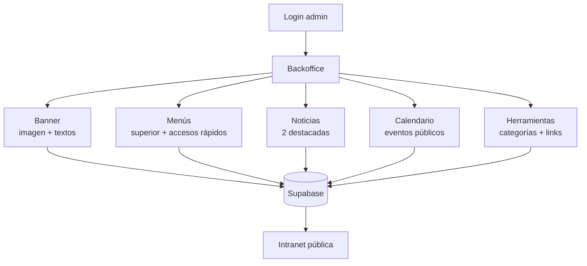
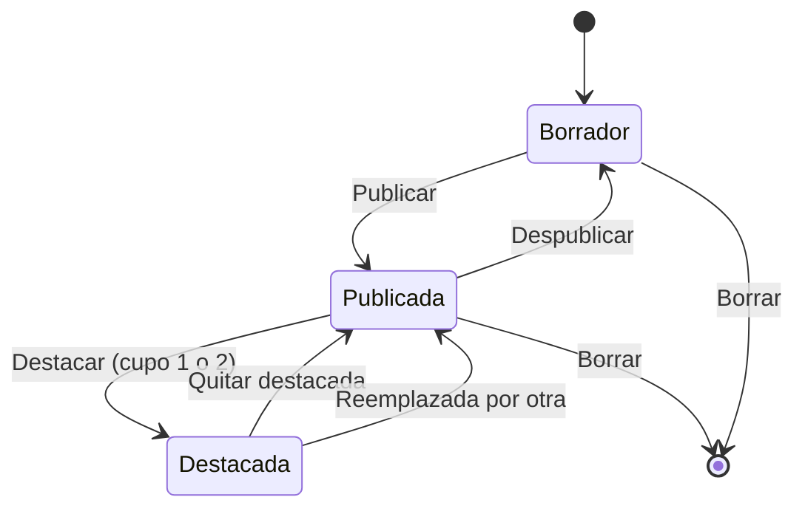
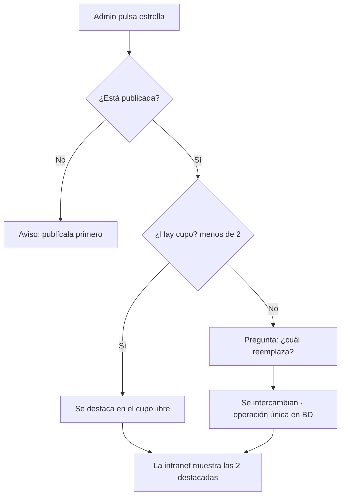
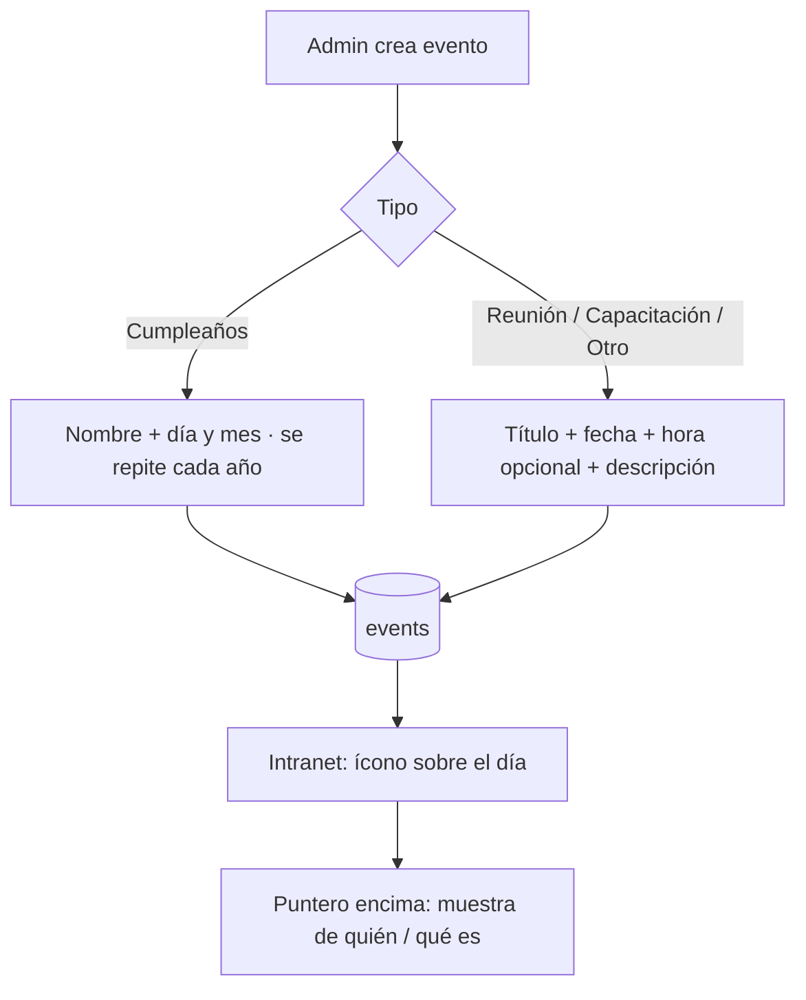

# Artefactos · Backoffice Intranet Pixel

Borrador visual de pantallas validado en la sesión (5 módulos: Banner, Menús, Noticias, Calendario, Herramientas). Aquí se congelan los flujos y estados.

## Mapa de módulos

## Estados de una noticia

## Flujo: destacar una noticia

## Flujo: evento en el calendario

## Reglas visibles en pantalla
- Menús: 1 nivel de submenú; el destino puede ser enlace, ancla o (luego) página interna.
- Banner sin imagen → fondo de píxeles.
- Noticias en borrador no se pueden destacar.
- Íconos de herramientas: catálogo cerrado (incluye torta y personas para calendario).
